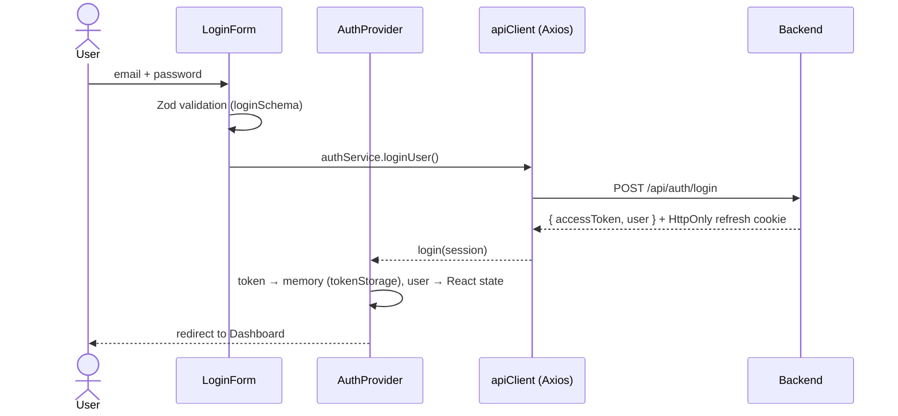
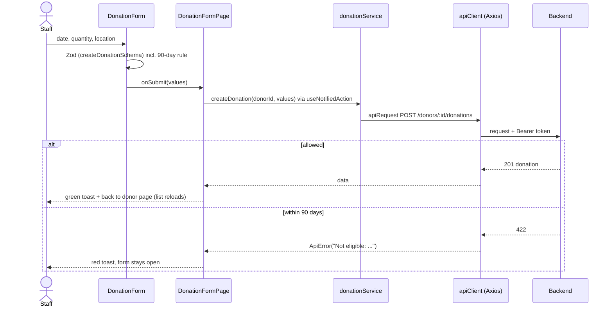

# Review walkthrough

A guide for presenting the project: folder structure, authentication flow, RBAC, and one feature end to end.
Each section ends with the files to open while explaining it.

## 1. Folder structure in one minute

The code is organised in layers. Each layer only uses the layers below it:

```
pages/            One component per route. Puts features together on a page.
  ↓
features/         Feature components that know the business (donors, donations, auth).
  ↓
components/ui/    Plain reusable pieces (Button, Input, Card...). No business logic, no fixed text.
hooks/            Reusable logic (forms, fetching, toasts, permissions).
  ↓
services/         The ONLY place that talks to the API. Components never call Axios.
  ↓
constants/        Every fixed value: routes, labels, messages, roles, limits.
```

**Rules that hold everywhere:** no text or numbers written directly in components (all in `constants/`); styling
only through CSS variables (`styles/tokens.css`); every API call has loading, error and empty states.

**Open:** `src/` tree, `src/constants/labels.js`, `src/components/ui/Button.jsx` (JSDoc + PropTypes).

## 2. Authentication flow



Points to explain:

- **Where the token lives:** the access token only in a JavaScript variable (`tokenStorage.js`), never in
  localStorage or sessionStorage, because an injected script can read those. The refresh token is in an HttpOnly
  cookie that JavaScript can't read at all. Details: `docs/token-storage.md`.
- **Every request:** the Axios **request interceptor** adds `Authorization: Bearer <token>`.
- **Token expired:** the server answers 401. The **response interceptor** asks `AuthProvider` to call
  `/auth/refresh` once, then repeats the original request. The user notices nothing.
- **Session over:** if the refresh also fails, the user is logged out and the Login page says
  "Your session has expired". Demo: log in, wait 3 minutes, click Donors.
- **Page reload:** memory is empty, so `AuthProvider` calls `/auth/refresh` at start-up while the guards show
  "Loading...".
- **Logout:** `/auth/logout` (server revokes the cookie), token and user cleared, redirect to Login.
- **Login errors are generic** ("Invalid email or password") so nobody can find out which emails exist.

**Open:** `services/apiClient.js` (both interceptors), `context/AuthProvider.jsx`, `services/tokenStorage.js`.

## 3. RBAC (role-based access control)

Three roles: **Admin**, **Staff**, **Donor**. Rules are enforced in three layers:

| Layer          | What it controls                      | Where                                                            |
| -------------- | ------------------------------------- | ---------------------------------------------------------------- |
| Pages and menu | Who can open a page / see a menu item | `ROUTE_ROLES` → `RoleRoute` (403 page) and `Sidebar` (`hasRole`) |
| Buttons        | Who sees Add / Edit / Delete          | `ROLE_PERMISSIONS` → `useCrudPermissions` (`hasPermission`)      |
| **Server**     | **What is actually allowed**          | Backend checks token + role on every request (401 / 403)         |

- The sidebar and the route guard read the **same** `ROUTE_ROLES` list, so a menu item and its page can never
  disagree.
- Hiding a button is UX, not security. Every place that hides something says so in a comment. The fake backend
  proves the server is the real gate: a Staff user calling delete directly gets **403**.
- New registrations are always **Donor**; the frontend never sends a role.

Demo: log in as Admin (sees Users, Delete), Staff (no Users, no Delete), Donor (Dashboard only; typing `/donors`
shows the 403 page).

**Open:** `constants/roles.js`, `features/auth/RoleRoute.jsx`, `components/layout/Sidebar.jsx`,
`hooks/useCrudPermissions.js`, `mocks/mockSession.js` (`withAuth`).

## 4. One feature end to end: "Add donation"



Step by step:

1. **UI:** `DonationForm` uses `useForm` with a Zod schema built from the donor's other donations, so a too-early
   date shows a red message under the field while typing. The submit button is disabled while saving (no double
   submit).
2. **Page:** `DonationFormPage.saveDonation` calls `createDonation` (or `updateDonation` in edit mode: the same page
   and form serve both) inside `useNotifiedAction`, which shows the success or error toast.
3. **Service:** `donationService.createDonation` calls `apiRequest`. It also maps **422** to the friendly
   "Not eligible" message.
4. **API layer:** `apiClient` adds the Bearer token, refreshes on 401, and turns any failure into an `ApiError` with
   a safe message. Raw errors and stack traces never reach the screen (`getErrorMessage`).
5. **Server:** checks the token, the role (Admin/Staff) and the 90-day rule again (`mocks/donationHandlers.js` now,
   Spring Boot later), and answers 201, 400, 403 or 422.
6. **Back in the UI:** on success the user returns to the donor page, which loads the list again, so the new
   donation and the updated eligibility banner appear.

**Open:** `features/donations/DonationForm.jsx`, `features/donations/donationSchema.js`,
`utils/donationEligibility.js`, `pages/DonationFormPage.jsx`, `hooks/useNotifiedAction.js`,
`services/donationService.js`, `services/apiClient.js`, `mocks/donationHandlers.js`.

## 5. Questions a reviewer may ask

**Why not localStorage for the token?** Any injected script can read it and send it away. Memory + HttpOnly cookie
keeps the long-lived token out of JavaScript entirely.

**Why a fake backend instead of hardcoded data?** It answers real HTTP requests, so the interceptors, tokens, 401,
403 and 422 handling are the real code paths. Switching to Spring Boot is one setting
(`VITE_USE_MOCK_API=false`).

**Where is the 90-day rule?** Once, in `utils/donationEligibility.js` (unit-tested), used by the form, the banner
and the server. Exactly 90 days is allowed, 89 is not, and back-filled dates are checked too.

**How do you avoid duplicate code?** One form per entity for add and edit; shared field rules
(`schemas/fieldSchemas.js`); one `DeleteDialog`, `RowActions`, `FormActions` and `useCrudPermissions` for donors
and donations; one `useFetch` for loading/error/retry.

**What happens if a component crashes?** `PageErrorBoundary` shows "Something went wrong" with Try again inside the
layout, never a blank page or a stack trace.

**React 19 ignores PropTypes at runtime. Why keep them?** They document every component's props and ESLint
requires them; the project standard asks for JSDoc + PropTypes.

**How would you add a new page?** Add the route to `ROUTES`, its roles to `ROUTE_ROLES`, one line to `NAV_ITEMS`,
and the `<Route>` in `App.jsx`. The sidebar, guard and highlight work automatically.
